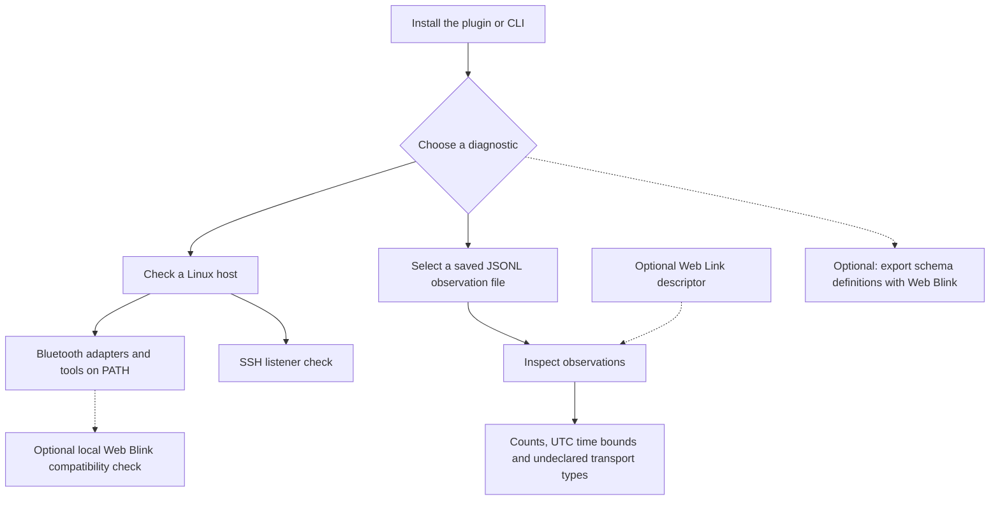

# Blink Debugger

Blink Debugger checks Linux host readiness and summarizes saved device observations. It runs with Python
3.8 or later. [Web Blink](https://github.com/patrick-1984/web-blink#use-web-blink-with-blink-debugger) is an
optional companion for Web Link descriptors. [Release v0.1.2](https://github.com/patrick-1984/blink-debugger/releases/tag/v0.1.2)
includes this guide, a plugin ZIP and a Python wheel.

## Install

In Claude Code, add the owner marketplace and install the plugin.

```text
/plugin marketplace add patrick-1984/marketplace
/plugin install blink-debugger@patrick-1984
```

In Codex, install the same plugin with the CLI.

```sh
codex plugin marketplace add patrick-1984/marketplace
codex plugin add blink-debugger@patrick-1984
```

For shell use, activate a virtual environment and install the wheel to get `bdbg`.

```sh
python3 -m pip install https://github.com/patrick-1984/blink-debugger/releases/download/v0.1.2/blink_debugger-0.1.2-py3-none-any.whl
```

The ZIP has a standalone script and example files. Download and extract it to try the sample on any Linux host with
Python 3.8 or later. [Release files and SHA256SUMS](https://github.com/patrick-1984/blink-debugger/releases/tag/v0.1.2)

```sh
base=https://github.com/patrick-1984/blink-debugger/releases/download/v0.1.2
curl -fLO "$base/blink-debugger-0.1.2.zip"
curl -fLO "$base/SHA256SUMS"
sha256sum --ignore-missing -c SHA256SUMS
python3 -m zipfile -e blink-debugger-0.1.2.zip blink-debugger-0.1.2
cd blink-debugger-0.1.2
python3 bdbg.py doctor
python3 bdbg.py inspect-observations examples/observations.jsonl --weblink examples/weblink.json
```

The sample contains seven observations across four transport groups. Its report lists counts and UTC time
bounds, plus the HTTP and Sub-GHz OOK types absent from the example descriptor.

## Common workflows



| Task | CLI | Plugin tool |
|---|---|---|
| Check adapters and local tools | `bdbg doctor` | `debugger_doctor` |
| Check if the host listens only for SSH | `bdbg check-listeners` | `debugger_check_listeners` |
| Summarize a saved export | `bdbg inspect-observations observations.jsonl` | `debugger_inspect_observations` |
| Compare with a saved Web Link descriptor | `bdbg inspect-observations observations.jsonl --weblink weblink.json` | `debugger_inspect_observations` with `weblink` |
| Check the installed Web Blink CLI | `bdbg doctor --probe-web-blink` | `debugger_doctor` with `probeWebBlink` set to true |

Supply absolute file paths to the plugin tools. Use `blink schemas export ./blink-schemas` to export Web
Blink's schema definitions. The `--weblink` argument accepts a Web Link descriptor such as the bundled
`examples/weblink.json`.

## Check both peers

Install both CLI wheels so `blink` and `bdbg` are on the same PATH. These commands were introduced in
Blink Debugger v0.1.1 and Web Blink v0.21.1.

```sh
bdbg doctor --probe-web-blink
blink peer discover blink-debugger
```

The debugger reports the supported descriptor edition. Web Blink reports the installed debugger version.
[Web Blink installation and peer guide](https://github.com/patrick-1984/web-blink#use-web-blink-with-blink-debugger)

## Host readiness

`doctor` lists Linux Bluetooth adapters registered by the kernel and finds `minion`, `blink` or `web-blink`, `rtl_433` and `ss` on the current PATH. A command name on PATH is evidence of executable discovery. Use its documented version or capability command if your workflow requires compatibility. Bluetooth registration alone does not establish successful pairing or GATT. The plugin checks the host on which it runs.

Use `bdbg doctor --probe-web-blink` to query the local Web Blink schema index. In MCP, set `probeWebBlink` to true on `debugger_doctor`. The probe reports `missing` when the executable is absent, `unavailable` when the command or its reply fails, and `compatible` for the tested descriptor edition 1.3.0. A different descriptor edition or index contract is `incompatible`. The check uses a fixed local CLI command, a five-second deadline and a 64 KiB response limit.

`bdbg capabilities` describes the Web Link descriptor and transport extension supported by the installed debugger. Web Blink can read it through that fixed CLI command. The response identifies the debugger version and the supported descriptor without probing hardware.

`check-listeners` checks TCP and UDP bindings in the current Linux network namespace with `ss`. Run it with sufficient socket owner visibility. It excludes loopback, accepts attributable SSH listeners on TCP 22 by default, and reports unexpected bindings. Use `--ssh-port` if this host uses another port. Exit 0 means pass, 1 means unexpected bindings, and 2 means incomplete attribution or an execution error. Routing and firewall rules determine reachability.

## Device observations

Provide UTF-8 JSON Lines with one object per line. Each record has `schemaVersion` (integer 1), `observedAt` (ISO 8601 with an explicit offset or Z), `source`, `kind`, `subtype` and `event`. Sources are `endpoint`, `adapter`, `device` and `fixture`. Events are `advertisement`, `connection`, `disconnect`, `message`, `notification` and `sample`.

| Kind | Subtypes |
|---|---|
| `web` | `http`, `https`, `websocket`, `other` |
| `network` | `tcp`, `udp`, `mqtt`, `other` |
| `bluetooth` | `ble`, `classic`, `other` |
| `radio` | `subghz-ook`, `subghz-fsk`, `lora`, `zigbee`, `other` |

The summary reports counts by source, transport and event, plus UTC time bounds. It reads the selected local input, rejects fields outside this contract, and fails the whole summary on invalid input or limits. It accepts at most 100,000 observations and 1,024 bytes per line. A summary describes the supplied file's coverage.

An optional v1 Web Link descriptor can declare transports using `x-blink-ext.blink-debugger`. The summary lists the declared types and the observed types absent from the declaration. The release test installs the pinned Web Blink v0.21.0 wheel, runs its schema export entry point, validates the example Web Link against the exported descriptor schema and checks the debugger summary. See [the compatibility pin](compat.json).

## AI Minion and device integrations

[AI Minion](https://github.com/patrick-1984/ai-minion/releases) has its own release history. The debugger's
host check reports whether `minion` is on PATH. A Minion Android integration requires a documented app-owned
export. A live Home Assistant check requires the supported integration for the exact device, firmware and
bridge, and an available test instance.
